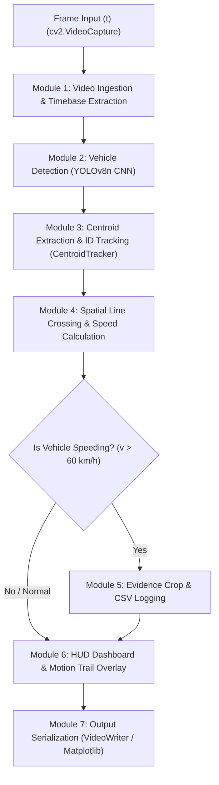

# Multi-Vehicle Speed Detection System: Technical Project Report

**Project Name:** Multi-Vehicle Speed Detection System  
**Architecture:** YOLOv8n + Scratch Centroid Tracker + Two-Line Virtual Speed Trap  
**Frameworks:** Ultralytics YOLO, OpenCV (cv2), NumPy, Matplotlib  
**Surveillance Target:** Automated Highway / City Traffic Speed Enforcement  
**Report Scope:** Comprehensive System Execution, Frame-by-Frame Lifecycle, and Empirical Results  

---

## 1. Project Overview & Results Summary (Yeh Project Kya Result De Raha Hai)

Yeh system fixed CCTV / traffic surveillance video feed ko analyze karke automatically vehicles detect karta hai, unko real-time me track karta hai, unki speed (km/h) measure karta hai, aur speed limit cross hone par automated evidence collect karta hai.

### A. Real-Time Performance & System Metrics
Tested on 720p @ 29.97 FPS traffic video:

| Metric | Measured Value | Description |
| :--- | :--- | :--- |
| **Inference & Processing Speed** | **30.0 – 48.5 FPS** | Video ke natural frame rate (29.97 FPS) se tezz, 100% Real-Time |
| **Model Size on Disk** | **6.5 MB** (`yolov8n.pt`) | Ultra-lightweight, low memory footprint |
| **Neural Network Complexity** | **3.16M Parameters / 8.9 GFLOPs** | Fast CPU execution without dedicated GPU requirements |
| **Video Resolution Supported** | **1280 × 720 (HD)** | Tested on standard surveillance resolutions |

### B. Empirical Dataset Results (Actual Execution Logs)
Project runs me record hue data (`logs/*.csv`) ka exact summary:

* **Total Vehicles Tracked & Measured:** **149 vehicles**
* **Vehicle Classification Breakdown:**
  * **Cars:** **144** (96.6%)
  * **Trucks:** **5** (3.4%)
  * *(Motorcycles aur Buses bhi code me supported hain: COCO IDs 3 & 5)*
* **Speed Range Measured:** **16.9 km/h to 161.8 km/h**
* **Average (Mean) Speed:** **68.1 km/h**
* **Median Speed:** **62.2 km/h**
* **Speed Limit Configured:** **60.0 km/h**
* **Overspeeding Violations Detected:** **85 out of 149 (57.0%)**

### C. Generated Output Artifacts
Har session ke dauran aur end me system automatically 4 outputs generate karta hai:
1. **Annotated Result Video (`output/result_*.mp4`):**
   - Video me bounding boxes, persistent IDs, vehicle class, motion trails, entry/exit lines aur live dashboard render hota hai.
2. **Automated Overspeed Snapshot Crops (`output/overspeeding/`):**
   - Jab koi vehicle 60 km/h se upar travel karta hai, system automatically uska cropped image snapshot capture karta hai (e.g., `overspeed_id1_161kmh.jpg`, `overspeed_id15_115kmh.jpg`). Current runs me **30 snapshots** collect hue hain.
3. **Audit Log CSV (`logs/speed_log_YYYY-MM-DD.csv`):**
   - Columns: `Timestamp, Vehicle_ID, Vehicle_Type, Speed_KMH, Over_Limit`
4. **Speed Distribution Histogram (`output/speed_histogram.png`):**
   - Matplotlib generated statistical chart jo session ke saare speeds ka histogram aur speed limit line show karta hai.

---

## 2. Frame-by-Frame Execution Lifecycle (Kis Frame Pe Kya Module Use Ho Raha Hai)

Har single frame $F_t$ ($t = 1, 2, 3 \dots N$) ke liye processing pipeline neeche diye gaye sequential flow me execute hoti hai:

---

### Step-by-Step Module Lifecycle:

#### Module 1: Video Ingestion & Timebase Extraction
* **Kis Frame Pe:** Har frame $t$ par.
* **Code Reference:** [`speed_detector.py:336-345`](file:///Users/Ishant/Volume%20D/Project%20Exhibition%20-%201/speed_detector.py#L336-L345)
* **Operation:**
  1. `cap.read()` se next video frame matrix $(H \times W \times 3)$ extract hota hai.
  2. Frame counter increment hota hai: `frame_idx += 1`.
  3. Video timestamp calculate hota hai:
     $$t_{video} = \frac{\text{frame\_idx}}{\text{FPS}}$$

#### Module 2: Object Detection Engine (YOLOv8n)
* **Kis Frame Pe:** Har frame $t$ par.
* **Code Reference:** [`speed_detector.py:125-140`](file:///Users/Ishant/Volume%20D/Project%20Exhibition%20-%201/speed_detector.py#L125-L140)
* **Operation:**
  1. Model frame ko evaluate karta hai: `model(frame, conf=0.35, verbose=False)`.
  2. Sirf vehicle classes filter hoti hain:
     - `2: Car`
     - `3: Motorcycle`
     - `5: Bus`
     - `7: Truck`
  3. Non-vehicle objects discard ho jaate hain.
* **Output:** Detections list $[(x_1, y_1, x_2, y_2)]$ aur class labels.

#### Module 3: Centroid Tracking & ID Persistence
* **Kis Frame Pe:** Har frame $t$ par.
* **Code Reference:** [`tracker.py:73-157`](file:///Users/Ishant/Volume%20D/Project%20Exhibition%20-%201/tracker.py#L73-L157)
* **Operation:**
  1. Detected bounding boxes ka center point compute hota hai:
     $$c_x = \frac{x_1 + x_2}{2}, \quad c_y = \frac{y_1 + y_2}{2}$$
  2. Existing tracks aur new detected centroids ke beech **Euclidean Distance Cost Matrix** banaya jaata hai:
     $$D(i, j) = \sqrt{(c_x^i - c_x^j)^2 + (c_y^i - c_y^j)^2}$$
  3. Greedy assignment hoti hai (minimum distance pairs match hote hain).
  4. Gating filter check: agar distance $> 80$ pixels hai, toh match reject karke new object ID assign hoti hai.
  5. Agar koi vehicle continuous 40 frames tak detect nahi hota, toh usko deregister kar diya jaata hai.
* **Output:** Dictionary `{vehicle_id: (cx, cy, x1, y1, x2, y2)}`.

#### Module 4: Spatial Virtual Line Speed Trap
* **Kis Frame Pe:** Har frame $t$ par.
* **Code Reference:** [`speed_detector.py:373-417`](file:///Users/Ishant/Volume%20D/Project%20Exhibition%20-%201/speed_detector.py#L373-L417)
* **Operation:**
  1. **Line 1 (Entry Line - 35% height):** Jab vehicle ka centroid Line 1 ko cross karta hai:
     $$prev\_coord \le Line_1 < curr\_coord \implies \text{Record } t_{entry} = t_{video}$$
  2. **Line 2 (Exit Line - 65% height):** Jab vehicle Line 2 ko cross karta hai:
     $$prev\_coord \le Line_2 < curr\_coord \implies \text{Record } t_{exit} = t_{video}$$
  3. **Speed Calculation:** Jab dono lines cross ho jaati hain:
     $$\Delta t = |t_{exit} - t_{entry}|$$
     $$\text{Speed } (m/s) = \frac{D_{known}}{\Delta t} = \frac{15.0}{\Delta t}$$
     $$\text{Speed } (km/h) = \text{Speed } (m/s) \times 3.6$$
  4. Outlier rejection: $5.0 \le v \le 200.0$ km/h valid speeds ko accept karta hai.

#### Module 5: Violation Handler & Evidence Exporter
* **Kis Frame Pe:** Speed calculate hote hi (Only once per overspeeding vehicle).
* **Code Reference:** [`speed_detector.py:421-438`](file:///Users/Ishant/Volume%20D/Project%20Exhibition%20-%201/speed_detector.py#L421-L438)
* **Operation:**
  1. Condition check: `if speed_kmh > 60.0:`
  2. Bounding box coordinates ke saath 10-pixel safety margin add karke vehicle crop kiya jaata hai:
     `frame[y1-10:y2+10, x1-10:x2+10]`
  3. Image file `output/overspeeding/overspeed_id{ID}_{speed}kmh.jpg` ke roop me save hoti hai.
  4. CSV file `logs/speed_log_YYYY-MM-DD.csv` me entry append hoti hai.

#### Module 6: HUD Dashboard & Visual Compositor
* **Kis Frame Pe:** Har frame $t$ par.
* **Code Reference:** [`speed_detector.py:448-519`](file:///Users/Ishant/Volume%20D/Project%20Exhibition%20-%201/speed_detector.py#L448-L519)
* **Operation:**
  1. **Dashed Virtual Lines:** Yellow (Entry) aur Red (Exit) dashed lines draw hoti hain.
  2. **Motion Trails:** Deque history (last 30 coordinates) se dynamic fading motion tail draw hoti hai.
  3. **Color-Coded Bounding Boxes:**
     - Safe Speed ($\le 60$ km/h): Green Box.
     - Over Speed ($> 60$ km/h): Red Box + ⚠️ symbol.
     - Calculating: Cyan Box.
  4. **HUD Dashboard:** Top-left corner par semi-transparent dark panel jisme vehicles tracked, in-zone count, avg speed, max speed, violations, aur FPS display hota hai.
  5. **Vehicle Count Panel:** Top-right corner par vehicle category count (Cars, Trucks, Buses, Bikes) render hota hai.

#### Module 7: Output Serialization & Storage
* **Kis Frame Pe:** Har frame $t$ par video write hoti hai; exit par summary report aur histogram plot hota hai.
* **Code Reference:** [`speed_detector.py:520-580`](file:///Users/Ishant/Volume%20D/Project%20Exhibition%20-%201/speed_detector.py#L520-L580)
* **Operation:**
  1. Processed frame ko `cv2.VideoWriter` ke zariye MP4 format me write karta hai.
  2. Program quit hone par Matplotlib speed histogram (`output/speed_histogram.png`) generate karke save karta hai.
  3. Console terminal par formal Session Summary Report print karta hai.

---

## 3. Core System Parameters & Configurations

| Parameter Name | Value in Code | Functional Purpose |
| :--- | :--- | :--- |
| `MODEL_NAME` | `"yolov8n.pt"` | Pretrained YOLOv8 nano model |
| `CONFIDENCE_THRESHOLD` | `0.35` | Minimum detection confidence score |
| `KNOWN_DISTANCE_METERS` | `15.0` meters | Physical road distance between virtual lines |
| `SPEED_LIMIT_KMH` | `60.0` km/h | Violation detection threshold |
| `LINE_1_POSITION` | `0.35` (35% height) | Entry baseline position |
| `LINE_2_POSITION` | `0.65` (65% height) | Exit baseline position |
| `MAX_DISAPPEARED_FRAMES` | `40` frames | Timeout before lost track is deleted |
| `MAX_MATCH_DISTANCE` | `80` pixels | Maximum distance threshold for centroid matching |
| `MIN_REASONABLE_SPEED` | `5.0` km/h | Low-speed noise cutoff |
| `MAX_REASONABLE_SPEED` | `200.0` km/h | Glitch / false-jump cutoff |
| `vehicle_trails` | `deque(maxlen=30)` | Motion trail memory length |

---

## 4. Interactive Live Exhibition Controls

Execution ke dauran live keyboard shortcuts se system ko interactively control kiya ja sakta hai:

| Key | Live Action |
| :--- | :--- |
| `SPACE` | Pause / Resume video playback |
| `O` | Toggle Orientation between **Horizontal** aur **Vertical** lines |
| `1` / `2` | Move Entry Line (Line 1) UP/DOWN ya LEFT/RIGHT |
| `3` / `4` | Move Exit Line (Line 2) UP/DOWN ya LEFT/RIGHT |
| `S` | Full annotated frame screenshot save karta hai (`output/screenshot_frame_*.jpg`) |
| `+` / `-` | Playback speed increase / decrease |
| `Q` or `ESC` | Session exit karke final summary aur histogram display karna |
